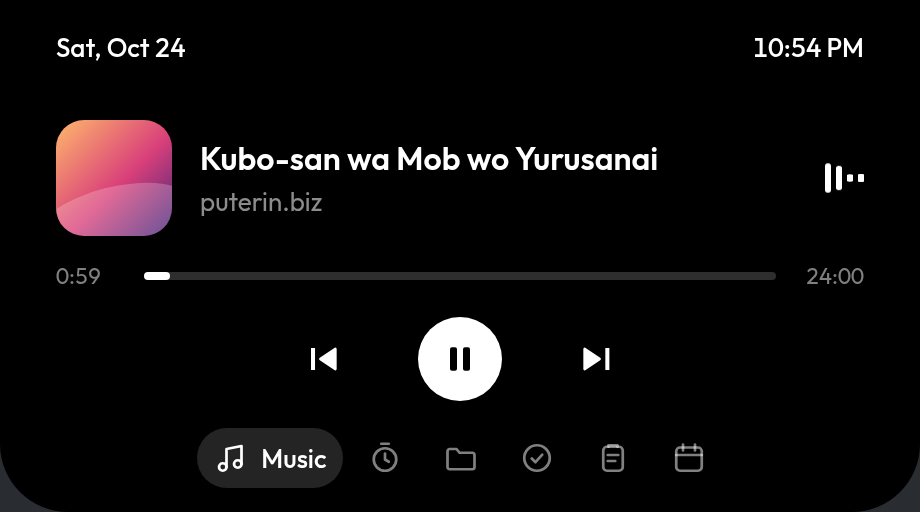
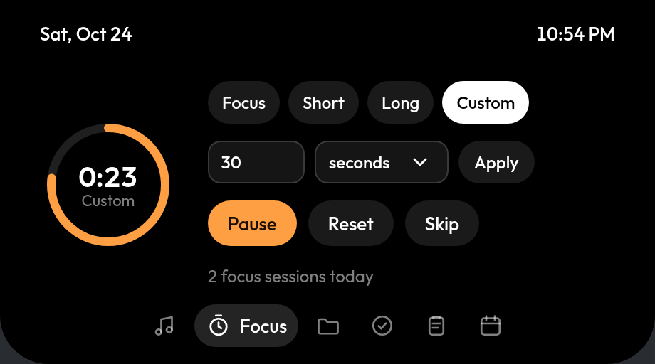
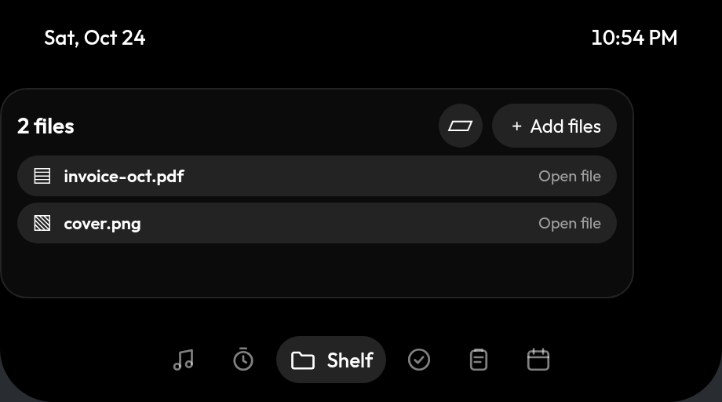
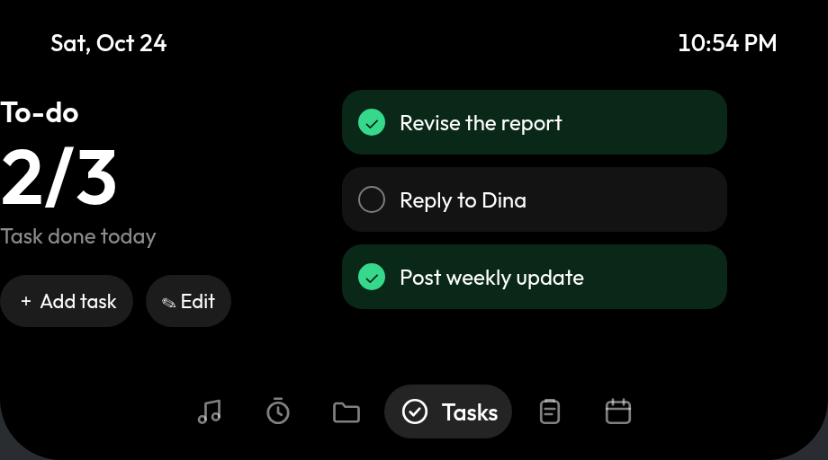
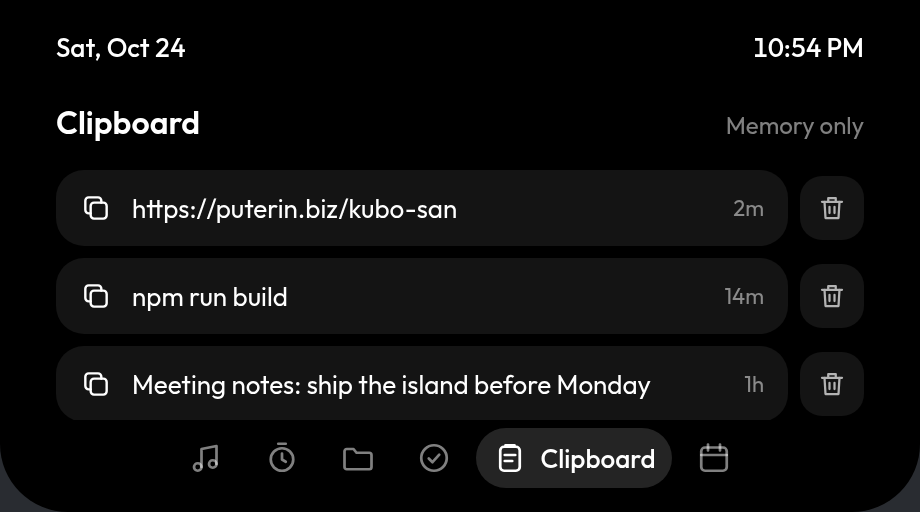
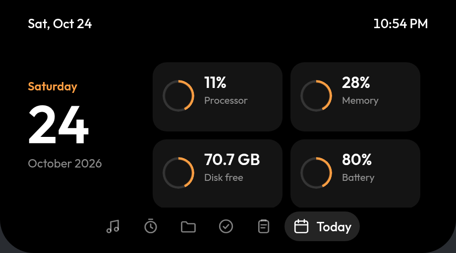
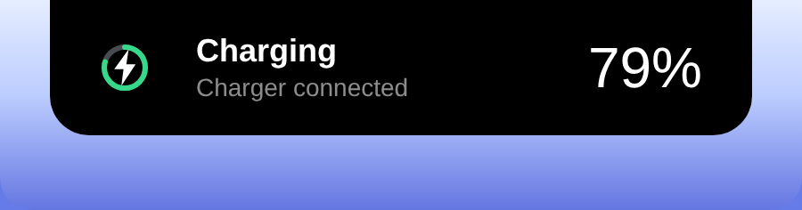
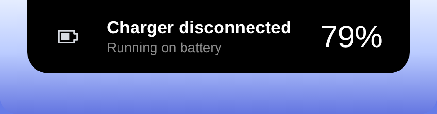
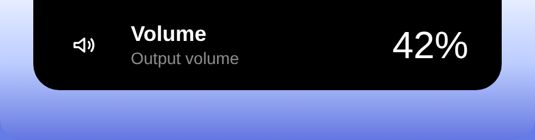

# Perdana Island

[](https://extensions.gnome.org/)
[](https://gjs.guide/)
[](https://gnome.pages.gitlab.gnome.org/gnome-shell/st/)
[](https://specifications.freedesktop.org/mpris-spec/latest/)
[](https://fedoraproject.org/)

Perdana Island is a GNOME Shell extension that places media controls, a focus timer, a file shelf, tasks, recent clipboard text, and system information in a compact island attached to the top edge of the desktop.

## Feature previews

These images show representative UI states with sample content. Media, battery, and system values in a running extension come from the current desktop session.

| Feature | Preview |
| --- | --- |
| Resting island |  |
| Music controls |  |
| Focus timer |  |
| Shelf |  |
| To-do |  |
| Clipboard |  |
| Today |  |
| Charging notice |  |
| Charger disconnected |  |
| Volume notice |  |

## Features

- Resting eyes react to the pointer; hovering also reveals the clock.
- Playing media and a running focus timer appear in compact form. Hovering opens the matching page.
- Music uses MPRIS metadata and supports seeking, previous, play/pause, and next when the player exposes those controls.
- Focus offers Focus, Short, Long, and custom durations in seconds or minutes. Completion shows a temporary notice.
- Shelf copies chosen files into a local folder, opens that folder, and refreshes when files change.
- To-do supports adding, completing, editing, and deleting tasks. Tasks persist between sessions.
- Clipboard keeps recent text in memory while its page is open. Entries can be recopied or removed; sensitive MIME types are skipped.
- Today shows available CPU, memory, disk, and battery information.
- Charging, charger disconnect, and output-volume changes show short notices.

## Architecture


The extension runs inside GNOME Shell through the GJS `Extension` lifecycle. Its interface is built from Shell `St` actors and Clutter layouts/animations, attached to GNOME Shell's chrome layer. GLib and Gio provide timers, file access, and filesystem monitoring. Media metadata and playback controls use MPRIS on the session D-Bus; output volume uses GNOME's Gvc mixer API and Shell volume status module. CPU, memory, disk, and battery readings are collected from Linux system interfaces when available.

The extension declares GNOME Shell **50.x** compatibility. It does not run on KDE Plasma, Cinnamon, Xfce, or other desktop environments that do not use GNOME Shell.

| Distribution / release | GNOME Shell | Support status |
| --- | --- | --- |
| Fedora Linux 44 | 50.6 on the development system | Runtime validated on Wayland |
| Ubuntu 26.04 LTS | 50.1 package | Version checked; runtime not independently tested |
| Debian testing (Forky) | 50.4 package | Version checked; runtime not independently tested |
| Other Linux distributions | GNOME Shell 50.x required | Expected to work; not individually tested |

GNOME Shell 49 and earlier, and 51 or later, are outside the compatibility range declared by this release. Wayland is the validated session; X11 has not been independently tested.

## Install

See [Installation](docs/INSTALLATION.md) for requirements, build/install, update, removal, and troubleshooting steps.

Quick install from this repository:

```sh
mkdir -p dist
gnome-extensions pack ./extension --out-dir ./dist
gnome-extensions install --force ./dist/perdana.island@perdana.shell-extension.zip
gnome-extensions enable perdana.island@perdana
```

## Use

Click the island to open it. When media or a focus timer is active, hovering over the island opens its page. Select a page from the tab bar. Press **Escape** or click outside to close it. See [How to use](docs/HOW-TO-USE.md) for each page's controls.

## Data and limitations

Tasks and Shelf files are stored in `~/.local/share/perdana.island/`. On first enable, matching task and Shelf data from the previous `~/.local/share/pulo-island/` directory is copied only when a destination file does not already exist. The previous directory is kept as a backup. Clipboard history is memory-only.

GNOME Shell does not provide the dragged desktop file list to these island actors. Add files through **Add files**, or copy them into the Shelf folder; direct drop onto the island is unavailable.

## Repository layout

```text
extension/                 GNOME Shell extension source
assets/screenshots/        Feature preview images
docs/                      Product requirements, usage, and installation guides
```

No license file is included yet; choose a project license before publishing the repository as open source.
