# Perdana Island

[](https://extensions.gnome.org/)
[](https://gjs.guide/)
[](https://gnome.pages.gitlab.gnome.org/gnome-shell/st/)
[](https://specifications.freedesktop.org/mpris-spec/latest/)
[](docs/releases/v79.2.md)
[](https://fedoraproject.org/)

Website: [island.perdana.ai.id](https://island.perdana.ai.id)

Perdana Island is a GNOME Shell extension for Shell 50 and 51. It places media controls, synced lyrics, a focus timer, a file shelf, tasks, notes, clipboard history, notifications, settings, and system information in a compact Notch or floating Pill. The repository also retains a separate KDE Plasma 6 widget and guide; v79.2 packages the GNOME extension. On GNOME, **Ctrl+Alt+X** hides or shows the island.

## GNOME v79.2

v79.2 is a behavior-preserving maintenance release. The GNOME source is split into focused domain modules, page renderers, and runtime helpers. `extension/extension.js` remains the entry point and drops from 11,866 to 9,147 lines. The interface, stored data formats, and desktop behavior are unchanged. See [v79.2 release notes](docs/releases/v79.2.md).

### v79.2 changes

- **Source layout:** domain logic (tasks, notes, focus, reminders, preferences, clipboard, Shelf, notifications, progress) lives in named modules with unit tests.
- **Page renderers:** each page builds its UI from explicit inputs and callbacks instead of reaching into the extension state.
- **Persistence:** file reads and guarded writes go through `state-store.js`, with the same paths and clipboard permission modes.
- **Activity:** removes a duplicate progress-bar child that produced a Clutter warning.
- **Shelf:** fixes the Clipboard tab, which failed to render after the split.
- **Checks:** `scripts/validate.sh` also verifies that every runtime module imports the GNOME libraries it uses.
- **Package:** GNOME metadata and archive use `v79.2`; KDE remains on its independent v76 track.

### Base release v79.1

v79.1 is a focused patch on v79. It fixes clipped Messages previews, makes conversation cards scroll and expand without covering following cards, removes the per-conversation number badges, and keeps the page-wide unread summary. It also removes browser URLs from chat previews and keeps the message timestamp aligned with the sender row. See [v79.1 release notes](docs/releases/v79.1.md) for the full patch and verification details.

#### v79.1 patch changes

- **Messages layout:** sender and latest-message preview use their own two-line column; timestamp stays aligned at the upper right. Long previews ellipsize on one line instead of being cut off.
- **Conversation list:** the scrollable list uses the available page height. Expanding a conversation triggers natural relayout and scrolls the card into view, so cards below it move instead of overlapping.
- **Unread clarity:** per-conversation number badges are removed. The page-wide unread total, unread row styling, message dots, and Mark all read action remain.
- **Chat text:** known WhatsApp, Telegram, and Google Chat website labels are stripped from chat notifications. Links to unrelated websites remain intact.
- **Package:** GNOME metadata and archive use `v79.1`; KDE remains on its independent v76 track.

#### Base release v79

v79 builds on the v78.19 feature set. It adapts merged Activity progress work from [PR #24](https://github.com/txtperdana/perdana.island/pull/24) and Quick Capture and backup improvements from [PR #25](https://github.com/txtperdana/perdana.island/pull/25) and [PR #26](https://github.com/txtperdana/perdana.island/pull/26). It adds a reworked Messages page for chat notifications, keeps every incoming message, and restores unread chat messages after logout. Cross-monitor movement is deferred. Release notes and known issues are in [docs/releases/v79.md](docs/releases/v79.md).

#### v79 changes

- **Messages:** chat notifications are grouped into one card per conversation. Expand a card to read every message in order. Each message has its own unread state, and `Mark all read` and `Clear` keep working.
- **No lost messages:** chat apps that reuse one notification object for each new message now produce a separate history row, so earlier messages are not overwritten.
- **Popup burst:** a WhatsApp popup shows up to three recent messages from the same conversation, with the count and `Reply` / `Open` actions.
- **Chat history after logout:** unread and recent chat messages are saved to `~/.local/share/perdana.island/messages.json` (mode 0600) and restored at the next login. `Open` does not work yet for restored messages; see the known issues.
- **Resting lyrics** no longer freeze until the island is opened.
- **Prayer reminders** match the v2 design: next-prayer highlight, card layout, and typography. Tomorrow's Fajr is not highlighted as today's next prayer.
- Activity can receive progress from compatible apps through the session D-Bus API `org.perdana.Island` and monitor partial downloads in the user's Downloads folder. aria2 totals are read from its control file; file contents are never opened.
- Activity rows update in place. Completed downloads remain available until selected, then open and dismiss; completed app activities expire after a short interval.
- Music detection now rejects podcast and episode titles even when the source is Spotify, while retaining legitimate soundtrack titles. Quick Capture understands more Indonesian and English date, weekday, time, period, priority, and note formats; impossible dates and invalid clock times stay in the captured title instead of silently changing.
- Backup files now use the nested v1 data format with app version, bounded lists, field filtering, and date/time validation. Restore still accepts the earlier flat local format, while excluding machine-only settings and clipboard contents.
- The GNOME package includes its new progress helper and runtime icons only. README screenshots remain in the source assets but are excluded from the extension archive.
- **Not included:** PR #17's movement between monitors. Existing page transitions and same-monitor placement remain part of the baseline.

GNOME and KDE have independent version tracks: GNOME is now v79.2, while the retained KDE Plasma widget remains v76.

## Feature previews

These images show representative UI states with sample media, files, notifications, and system values. They are examples, not live readings from your current desktop session.

| Feature | Preview |
| --- | --- |
| Resting island |  |
| Resting lyrics | 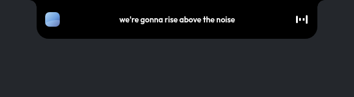 |
| Bottom placement | 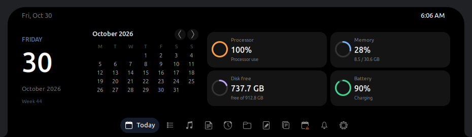 |
| Music controls | 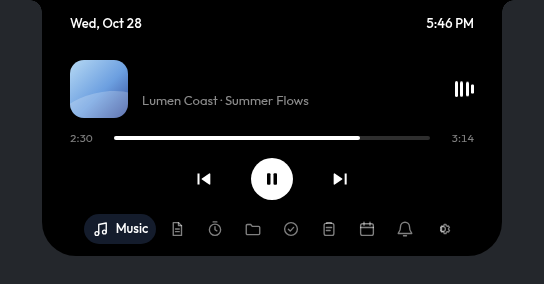 |
| Lyrics | 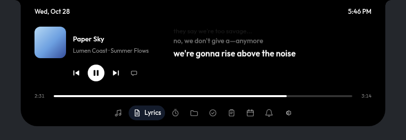 |
| Focus timer | 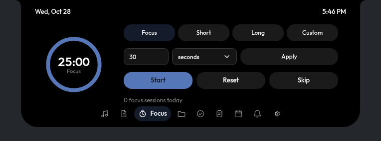 |
| Shelf grid | 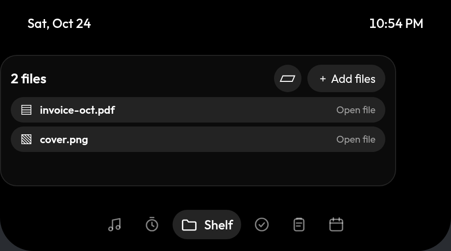 |
| Shelf list | 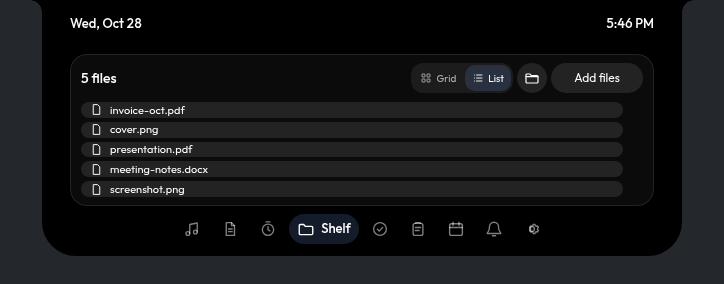 |
| To-do | 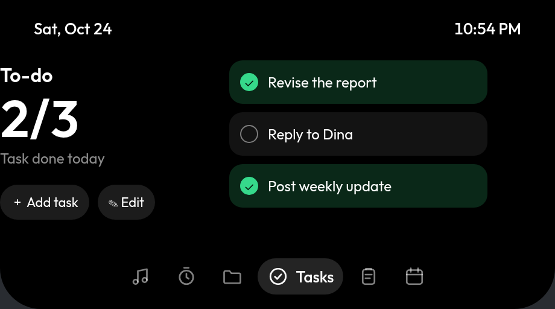 |
| Quick capture | 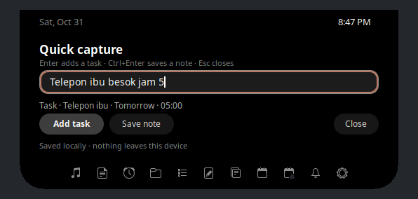 |
| Notes | 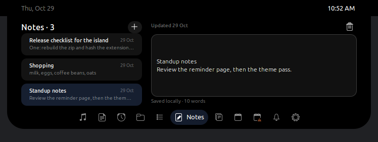 |
| Clipboard | 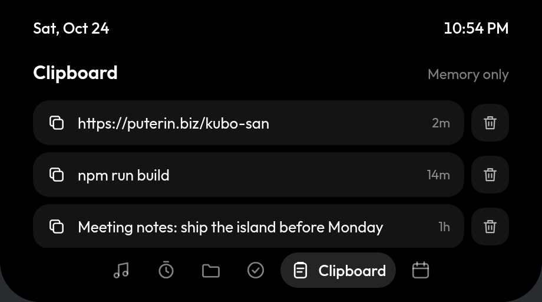 |
| Today | 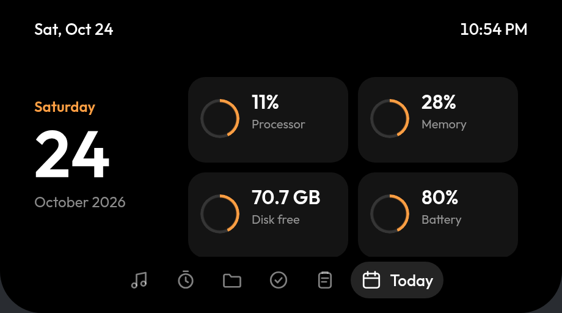 |
| Notifications | 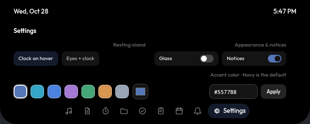 |
| Settings | 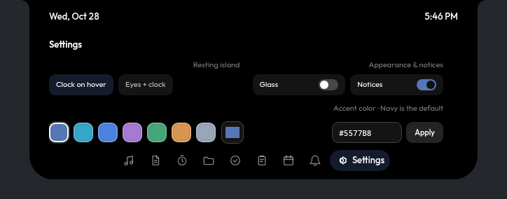 |
| Backup and restore | 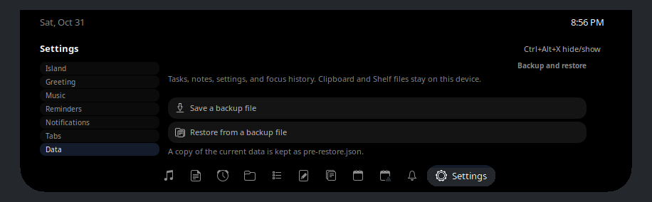 |
| Activity | 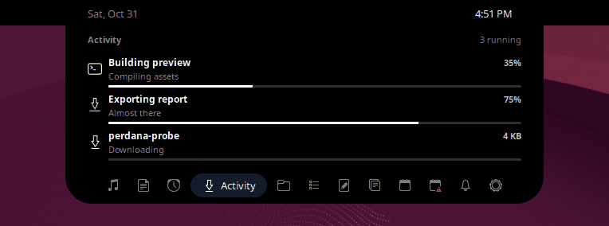 |
| Charging notice | 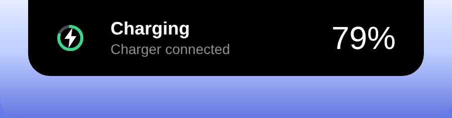 |
| Charger disconnected | 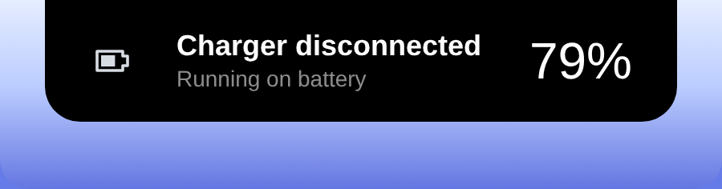 |
| Volume notice | 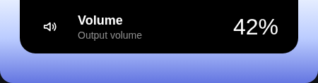 |

## Features

- Resting eyes react to the pointer; settings choose between a clock on hover and eyes beside a visible clock. **Ctrl+Alt+X** hides or shows the island.
- The island can be dragged to the top, bottom, left, or right edge, or left at a free position. It stays horizontal. Settings → Island → Position offers the same locations.
- Drag tabs to reorder them. Clicking the compact island opens the first tab, and the order is saved locally.
- Motion smooths island opening, tab changes, button feedback, progress, and focus-ring updates. It follows GNOME's **enable-animations** preference.
- Playing media and a running focus timer appear in compact form. Hovering opens the matching page.
- Music uses MPRIS metadata and supports seeking, previous, play/pause, and next when the player exposes those controls.
- Smart music detection checks player service and track metadata before showing playback. It recognizes common music services such as Spotify, YouTube Music, YouTube, Deezer, SoundCloud, and Apple Music, while filtering spoken programs, films, social video, and ambiguous sessions. Turn it off under Settings → Island.
- Lyrics follow playback timestamps. When a player does not provide synced lyrics, the extension looks up track metadata with LRCLIB. The Lyrics page includes playback controls and a toggle to show the current lyric in the resting island; long lines wrap inside the fixed layout.
- Focus offers Focus, Short, Long, and custom durations in seconds or minutes. Completion shows a temporary notice. While a session runs, Focus guard checks the focused window and shows one notice after five minutes in YouTube, Netflix, Twitch, TikTok, Instagram, Facebook, Reddit, or X. It reads only the window class and title, keeps the counter in memory, and can be turned off in Settings.
- Shelf offers Grid and List views, image thumbnails, a scrollable list capped at 10 visible items, and a local folder that refreshes when files change. A capture button saves the current screen into that folder through the desktop screenshot portal.
- To-do supports adding, completing, editing, and deleting tasks. Tasks persist between sessions. A task can carry a time (24 hour) and a priority (High, Med, Low); timed tasks sort to the top, and the list marks tasks whose day has passed as late.
- Clipboard keeps up to 25 recent text entries between sessions, shown inside the Shelf page with a Files | Clipboard switch. It records changes while the extension is enabled, deduplicates repeated text and URLs, masks email addresses and links in previews, and skips explicitly identified credentials.
- To-do also shows a daily summary: scheduled tasks with the next time, tasks completed today, focus minutes, and a Copy report action that puts a plain text report on the clipboard.
- At 08:00 the island can show a morning agenda notice with today's scheduled tasks, and at 17:00 a recap of completed tasks and focus minutes. Clicking either notice opens the matching page. Both are toggled under Daily agenda in Settings.
- Notes is a local scratchpad with a list on the left and a wrapping editor on the right. The first line becomes the row title, **Enter** starts a new line, **Escape** leaves the editor, and text saves to `notes.json` shortly after typing stops. Deleting a note leaves a seven second Undo row, and empty notes are dropped when the page is left.
- Settings are split into **Island**, **Greeting**, **Music**, **Messages**, **Reminders**, **Notifications**, **Tabs**, and **Data** side sections. Chat apps are on Messages; system alerts stay on Notifications. They control themes, Notch/Pill shape, browser tuck, island position, resting style, glass, accent color, notices, app notification filters, keep awake, greeting text and name, reminders, and visible page tabs.
- Keep awake asks GNOME's session manager for idle and suspend inhibitors while it is on. The switch is under Island and the inhibitor is released as soon as it is turned off or the extension is disabled.
- Themes change the island material without touching the layout. Midnight is the plain black island, Aero adds a blue gloss band with a hairline border, Aqua uses rounded translucent graphite, Yaru uses an aubergine tint, and Graphite uses flat grey with small corners. The choice persists between sessions, and translucent themes hide the solid corner ears so the glass edge stays clean.
- Water reminders can show a short notice every hour between 08:00 and 21:00 while the island is idle.
- Prayer reminders fetch the five daily times from the Aladhan API for a city, cache them per day, and show a notice at each time. The calculation method can be switched between Kemenag, MWL, ISNA, and Umm al-Qura. Times are converted from the city timezone to the local clock.
- The Reminders page lists the five prayer times for today, marks the next one, dims the ones that have passed, and shows the water countdown with a Log glass action. Tapping a water or prayer notice opens the page. Refresh re-fetches the times when the city or the connection changes.
- Today combines a local calendar with available CPU, memory, disk, and battery information.
- Notifications lists recent desktop notifications, uses the source application's icon when available, and can activate or clear them.
- Session greetings show a customizable first-use welcome and a returning greeting on later desktop login sessions. Choose the Linux account name, device name, or a custom name; edit both messages with `{name}` as the insertion token; preview either message from Settings. Greetings can be disabled independently of other system notices.
- Charging, charger disconnect, output-volume changes, hardware brightness changes, and completed focus sessions can show short notices.

## Architecture


The extension runs inside GNOME Shell through the GJS `Extension` lifecycle. Its interface is built from Shell `St` actors and Clutter layouts/animations, attached to GNOME Shell's chrome layer. GLib and Gio provide timers, file access, and filesystem monitoring. Media metadata and playback controls use MPRIS on the session D-Bus; output volume uses GNOME's Gvc mixer API and Shell volume status module. CPU, memory, disk, and battery readings are collected from Linux system interfaces when available.

The GNOME extension declares GNOME Shell **50.x and 51.x** compatibility. This GNOME package does not run on KDE Plasma, Cinnamon, Xfce, or other desktop environments that do not use GNOME Shell. KDE users should follow the separate widget's guide in [README-KDE.md](README-KDE.md).

| Distribution / release | GNOME Shell | Support status |
| --- | --- | --- |
| Fedora Linux 44 | 50.6 on the development system | v79.2 build, package, headless render, and live lyrics, notifications, tab drag, and Shelf checked |
| Ubuntu 26.04 LTS | 50.1 package | Version checked; v79.2 runtime not independently tested |
| Debian testing (Forky) | 50.4 package | Version checked; v79.2 runtime not independently tested |
| Ubuntu 26.10 | 51.0 on a previous test system | Earlier baseline smoke-tested in headless Wayland; v79.2 not independently tested |
| Other Linux distributions | GNOME Shell 50.x or 51.x required | Expected to work; not individually tested |

GNOME Shell 49 and earlier, and 52 or later, are outside the compatibility range declared by this release. The v79.2 source has unit, syntax, schema, import, and package checks, plus isolated headless render checks. GNOME Shell loads an extension module once per session, so an already-running session keeps the previous code until it is logged out and back in. X11 has not been independently tested.

## Install

See [Installation](docs/INSTALLATION.md) for requirements, install, update, removal, and troubleshooting steps.

Quick install from this repository:

```sh
./scripts/package-release.sh v79.2
gnome-extensions install --force ./dist/Perdana-Island-GNOME-v79.2.shell-extension.zip
gnome-extensions enable perdana.island@perdana
```

## Platform packages and releases

The repository keeps the GNOME extension and KDE Plasma widget as separate packages. Their versions may differ:

- `Perdana-Island-GNOME-v79.2.shell-extension.zip` for GNOME Shell 50 and 51.
- KDE Plasma uses its own package and installation instructions in [README-KDE.md](README-KDE.md).

Build the current GNOME package with `./scripts/package-release.sh v79.2`. GNOME releases use `v<number>` tags, with optional patch numbers such as `v79.2`; KDE releases use `plasma-v<number>` tags and package only the Plasma widget. Neither package changes the other platform's version.

## Use

Click the island to open it. When media or a focus timer is active, hovering over the island opens its page. Select a page from the tab bar. Press **Escape** or click outside to close it. See [How to use](docs/HOW-TO-USE.md) for each page's controls.

## Data and limitations

Tasks, notes, preferences, clipboard history, and Shelf files are stored in `~/.local/share/perdana.island/`. Task data is reconciled with `~/.local/share/pulo-island/tasks.json` and synchronized to both locations, so changes survive switching between the old and new extension UUIDs. Shelf files are copied from the previous location when a matching destination file is absent. Clipboard history is stored locally with user-only permissions and keeps up to 25 unique entries. It is monitored while the extension is enabled; repeated copies do not create duplicate rows. Clipboard text is not sent to third parties. LRCLIB lyric lookup sends the current track title, artist, optional album, and duration to `lrclib.net`.

GNOME Shell does not provide the dragged desktop file list to these island actors. Add files through **Add files**, or copy them into the Shelf folder; direct drop onto the island is unavailable.

## Repository layout

```text
extension/                   GNOME Shell extension source (packaged)
  extension.js               Composition root and extension lifecycle
  *-domain.js, *-utils.js    Pure logic with unit tests
  *-page.js, *-list.js, ...  Page renderers and shared controls
  stylesheet.css             Island and page styles
  schemas/                   GNOME preferences schema
  assets/                    Runtime icons only
plasma-widget/               Separate KDE Plasma 6 widget
assets/screenshots/          README feature previews (not packaged)
docs/                        Install, usage, and release notes
scripts/                     GNOME/KDE packaging and validation
tests/                       Unit tests for parsers, privacy, backup, and progress
dist/                        Local package output; not committed
```

Release packages contain only `extension/` plus `LICENSE`. Preview screenshots, the KDE widget, and generated archives are not part of the GNOME package.

The GNOME extension is distributed under [GPL-3.0-or-later](LICENSE), a license compatible with GNOME Shell's GPL-2.0-or-later terms.

## Contributions and credits

### [Perdana (@txtperdana)](https://github.com/txtperdana)

- **GNOME foundation:** created the Shell extension lifecycle, top-attached island, resting and expanded states, responsive page widths, tab navigation, and transitions. Built Music controls over MPRIS, LRCLIB lyric lookup and sync, the focus timer, Shelf file handling, To-do, local clipboard history, Today metrics, desktop notices, and Settings.
- **Persistence and migration:** added local storage for tasks and clipboard history, carried task and Shelf data forward from the former `pulo-island` data folder, and maintained settings across extension sessions.
- **KDE port:** created the separate Plasma 6 widget, its supported Music, Focus, Tasks, and Clipboard pages, and KDE-specific installation, usage, and compatibility documentation. GNOME and KDE code, package contents, and version tracks remain separate.
- **Project maintenance:** owns product direction, design reviews, release packaging, versioning, screenshots, README and how-to guides, and integration of community changes. Reviewed and merged contributor work while preserving attribution in this README.
- **v70:** implemented first-session and returning-session greetings; added account, device, and custom display-name choices; editable welcome and return text with a `{name}` token; preview buttons; and once-per-login greeting state. Split Settings into Island, Greeting, Reminders, and Tabs side sections, with scroll-safe content in each section.
- **v71:** added configurable MPRIS music classification to keep podcasts, movies, social videos, and ambiguous media out of the music island; refined Notes spacing and safe insets; and guarded Keep awake against delayed session-manager replies.
- **v72:** added Settings → Notifications controls for app banners from WhatsApp, Discord, Telegram Web/Desktop, and Google Chat; added Notch/Pill shape selection, browser-overlap tuck-away, and a hardware brightness OSD. GNOME retains control of desktop notifications and brightness changes.
- **v78:** adds quick capture (Ctrl+Alt+N and the + beside the clock, with a live preview), a Messages page grouped by sender, Shelf with a Files | Clipboard switch and 25 clipboard entries, a Summary page, Prayer and Water split tabs under Reminders, Notifications with Alerts and Activity tabs (download progress with a compact pill), browser logos on web alerts, Settings → Messages, and Settings → Data with backup and restore (desktop file dialog, with a folder fallback).
- **v78.2:** makes `island-pages-v2.html` the current interface reference, adds the Settings Data section to that preview, and makes GNOME Settings navigation scroll while keeping the selected section visible. Aligns the local README, build instructions, and release notes with the v78.2 archive.
- **v78.3:** places the quick-capture button beside the clock with safe spacing; updates the capture chips without destroying the focused input; preserves parsed dates and times on tasks, including date-only tasks; and displays date-only tasks in the task list and daily agenda without inventing a time.
- **v78.4:** aligns Summary with the v2 preview, adds custom line icons for the tab bar and Summary cards, updates media controls when playback changes, refreshes synced lyrics when background lookup finishes, keeps focus/task/message summaries current, and updates the Shelf Clipboard count and list when text is copied.
- **v78.10:** keeps the Summary playback visualizer animated while the Summary page is open and media is playing.
- **v78.11:** gives the Notes heading and New button fixed non-overlapping allocations; centers the empty-note prompt in its card; removes hover fills and overlapping outgoing-page layers on tab switches; and removes the redundant Summary music-card border.
- **v78.12:** advances resting lyrics with an independent background ticker; replaces lyrics immediately before a brief fade-in so rapid lines cannot stall; centers resting text in a fixed-width overlay; removes Music and Clipboard from the standalone Visible tabs list; and adds a subtle directional page transition.
- **v78.13:** vertically centers resting track titles and lyrics based on their natural wrapped height, measures lyric fit against the actual text width, and constrains browser/message banners to the notch by flattening line breaks, ellipsizing long text, and clipping overflow.
- **v78.14:** measures resting lyric line count with Pango so the text stays visible and centered; classifies browser alerts carrying `web.whatsapp.com` as WhatsApp chat messages; removes that site address from the preview; and flattens, truncates, and clips notification and Messages rows to prevent text escaping their cards.
- **v78.15:** removes temporary Pango layout/font-description objects from resting-lyric measurement to prevent GNOME Shell memory corruption; caps parsed lyrics at 500 lines; and renders only nine lyric labels around the active line to reduce allocations and animations.
- **v78.16:** routes browser notifications from WhatsApp Web, Google Chat, and Telegram Web to Messages when their source or notification identifies the site; removes site addresses from chat previews; and exposes the originating app's Reply action in Messages when one is available.
- **v78.17:** broadens Google Chat matching across PWA/app IDs and Google Chat web domains; routes identified Google Chat Web notices to Messages; separates the automatic Water reminder schedule from the manual glass log; and leaves the log unchanged when an automatic reminder appears.
- **v78.18:** adds Google Chat address variants used in Gmail-hosted Chat and the standalone web app to notification routing and URL cleanup, and keeps the manual water log distinct from timer-driven reminders.
- **v78.19:** recognizes the installed Edge Google Chat PWA ID, stops Activity-page flicker during download updates, and keeps completed downloads visible until opened.
- **v79:** adapts Activity progress from merged PR #24 and Quick Capture/backup improvements from PRs #25 and #26; filters podcast episodes from music detection, expands Indonesian/English capture parsing, writes a versioned nested backup while keeping flat local backups readable, and trims runtime package contents. Keeps GNOME and KDE package versions independent and defers cross-monitor movement.
- **v79.1:** fixes Messages card clipping and expansion layout, removes per-conversation unread number badges while keeping unread state, strips browser URLs from chat previews, and publishes the versioned GNOME package. KDE version remains unchanged.
- **v73:** fixed auto-close after pointer exit for click- and hover-opened islands; standardized typography on installed Cantarell with Noto Sans fallback; tightened panel/page clipping; and improved notification identity matching for Telegram Desktop and the Google Chat Edge PWA. Browser-hosted sites remain identifiable only when GNOME exposes app/site metadata.

### mteguhfh

PRs #1–#11 and #24 are merged. PRs #12 and #13 were closed without merging; compatible motion and same-monitor layout behavior were adapted in v73. PRs #25 and #26 were closed without merge after their parser and backup improvements were adapted into v79 on `main`; existing UI and legacy backup support were retained.

- [PR #1 — Clipboard privacy](https://github.com/txtperdana/perdana.island/pull/1): masks dotted email addresses more completely and skips explicitly named API keys, access and refresh tokens, generic token fields, client secrets, authorization values, and private-key blocks. The checks target credential-shaped fields rather than treating ordinary copied text as a password.
- [PR #2 — Contribution workflow](https://github.com/txtperdana/perdana.island/pull/2): adds the contributor guide, bug-report and feature-request templates, and pull-request template.
- [PR #3 — KDE clipboard monitoring](https://github.com/txtperdana/perdana.island/pull/3): records clipboard changes while the widget is running even when its popup is closed; skips KDE password-manager MIME data; truncates long text safely; and moves a recopied item to the top of the history.
- [PR #4 — GNOME Shell 51](https://github.com/txtperdana/perdana.island/pull/4): replaces the removed `St.BoxLayout.vertical` property with `Clutter.Orientation.VERTICAL`, supporting both declared GNOME Shell 50 and 51 versions.
- [PR #5 — v69 packaging](https://github.com/txtperdana/perdana.island/pull/5): prepares the v69 release metadata and separate GNOME Shell and KDE Plasma archives with matching version numbers and documentation.
- [PR #6 — GNOME themes](https://github.com/txtperdana/perdana.island/pull/6): adds Midnight, Aero, Aqua, Yaru, and Graphite materials, with theme-specific surface colors, gloss, borders, and corner treatments.
- [PR #7 — Daily agenda and recap](https://github.com/txtperdana/perdana.island/pull/7): adds scheduled tasks, morning agenda and evening recap notices, completed-today counts, focus-minute totals, and a copyable daily report.
- [PR #8 — Shelf capture and focus guard](https://github.com/txtperdana/perdana.island/pull/8): adds screenshot capture through the desktop portal and warns once after five minutes in a supported distraction app while a focus session is active.
- [PR #9 — Water and prayer reminders](https://github.com/txtperdana/perdana.island/pull/9): adds hourly water reminders, configurable prayer-time reminders fetched from Aladhan, city and calculation-method settings, a Reminders page, and a daily cache.
- [PR #10 — KDE feature parity](https://github.com/txtperdana/perdana.island/pull/10): brings daily agenda, water and prayer reminders, and the five themes to the Plasma widget, with KDE-native settings and notifications.
- [PR #11 — Notes and keep awake](https://github.com/txtperdana/perdana.island/pull/11): adds a Notes page with a wrapping editor, autosave to `notes.json`, a seven second delete undo, empty-note cleanup, a tighter tab bar that fits the extra page, and a Keep awake switch that holds idle and suspend inhibitors and releases them when turned off or when the extension is disabled.
- [PR #12 — Motion polish](https://github.com/txtperdana/perdana.island/pull/12) (**closed, not merged; adapted in v73**): smooths island and page transitions, button feedback, media progress, notices, and the focus ring; adds hover lift and a moving active-tab highlight while respecting GNOME's animation setting.
- [PR #13 — Draggable tabs and island placement](https://github.com/txtperdana/perdana.island/pull/13) (**closed, not merged; adapted in v73**): lets people reorder tabs and position the island on the current monitor; cross-monitor movement remains deferred.
- [PR #24 — Activity progress](https://github.com/txtperdana/perdana.island/pull/24) (**merged; adapted in v79**): adds app-reported Activity through session D-Bus, partial-download tracking, aria2 total-size parsing, and Activity progress screenshots. v79 keeps completed downloads until the user selects them.
- [PR #25 — Quick Capture](https://github.com/txtperdana/perdana.island/pull/25) (**closed without merge; adapted in v79**): expands Indonesian and English date, weekday, time, period, and priority parsing. The existing capture UI and `Catatan:` note flow stay in place; invalid dates and clock values remain visible instead of being silently normalized. It was closed after publication to avoid duplicating the feature and reintroducing stale packaging details.
- [PR #26 — Backup and restore](https://github.com/txtperdana/perdana.island/pull/26) (**closed without merge; adapted in v79**): uses a versioned nested JSON shape and filters local-only state. v79 retains the earlier flat backup format for restore compatibility. It was closed after publication to avoid duplicating the Settings → Data implementation and stale packaging changes.
